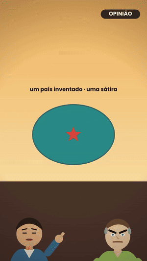
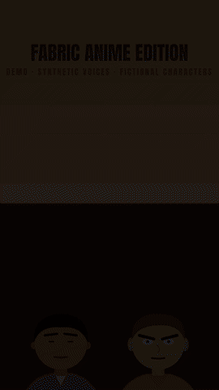
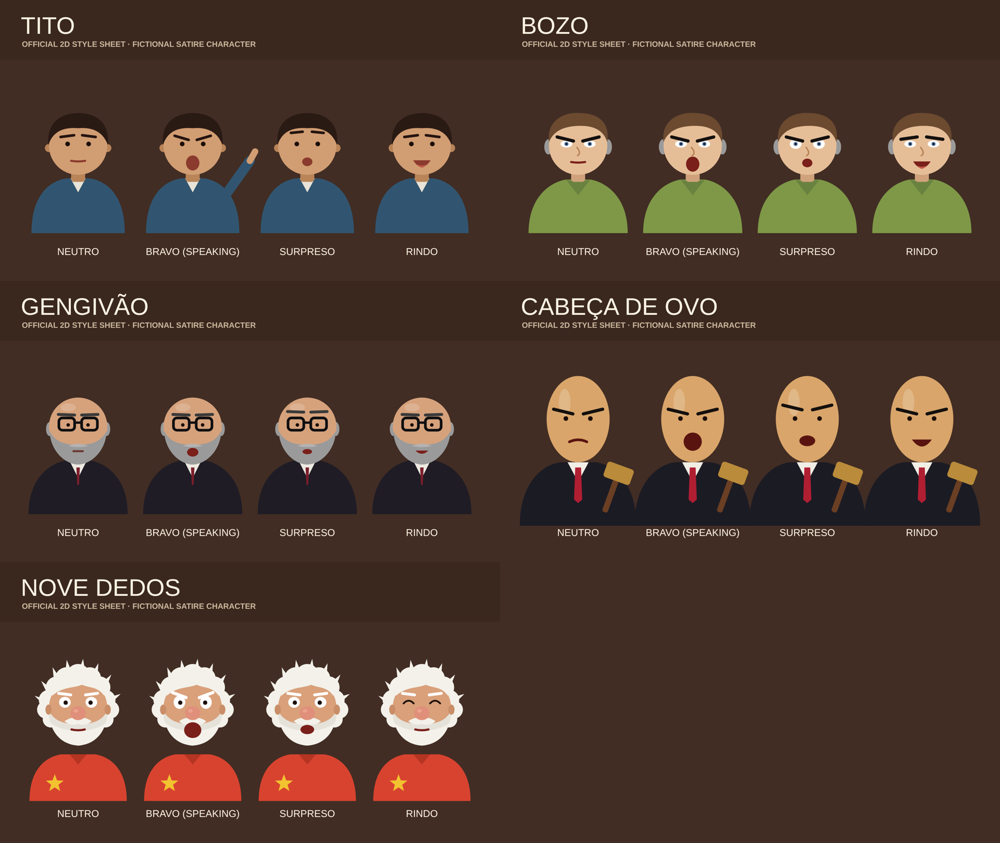
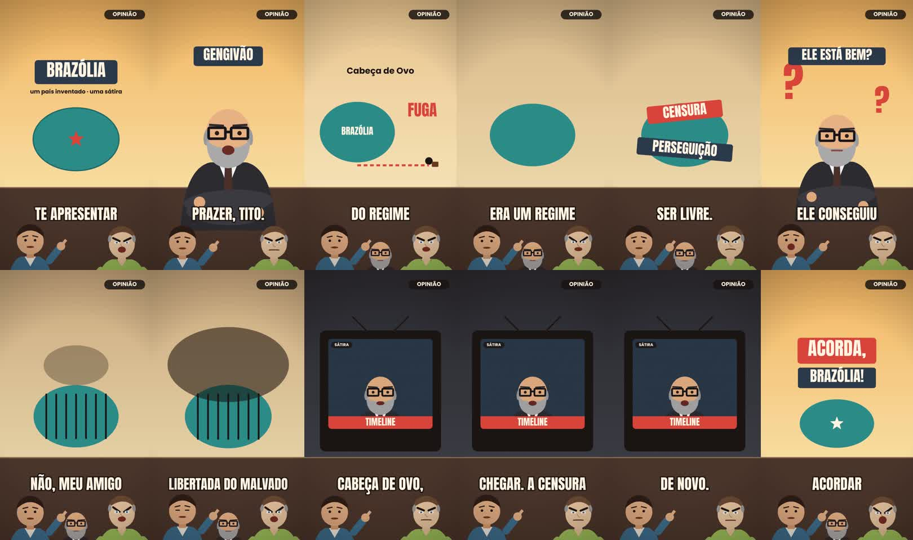
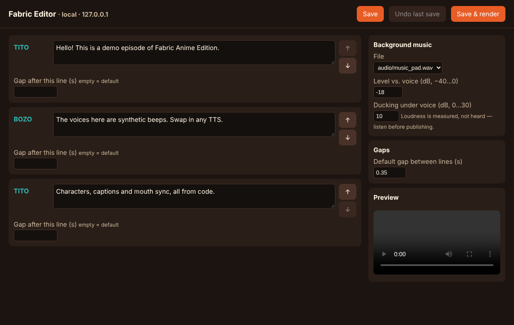

# Fabric Anime Edition

**🇬🇧 English** · [🇧🇷 Português](README.pt-BR.md)

[](https://github.com/theobarros22/fabric-anime-edition/actions)    

> An open, code-first factory for **2D flat-vector animated shorts** (3D-ready by design):
> scripts → characters → voices → cuts → caption/mouth sync → editable timeline → vertical video.

<p align="center"> &nbsp; </p>

Born from a real production pipeline (satirical shorts set in the fictional country *Brazólia*). This repo extracts
**only what proved itself** from that work and leaves the rest of the studio behind, so that newcomers can contribute
without having to understand a large private engine.

## Why Fabric Anime Edition is different

Most "AI video" tools give you a slot machine. Most editors give you a blank timeline. Fabric gives you a **repeatable, cheap, consistent production line** for character-driven shorts:

| What you get | Why it matters | Evidence |
|---|---|---|
| **Same character, every frame, every episode** | Characters are code (SVG), not generated images — no drifting faces, no re-rolls | `characters/personagens.js`, `media/characters/` |
| **Deterministic frames** | `R(t)` is a pure function of time: same input ⇒ same pixels. Easy to test, diff and review | Cached vs. uncached output was identical in our benchmarks |
| **Edit a caption → only that part re-renders** | The frame cache keys on what a frame *looks like*, not on the whole timeline | Demo: editing one line re-rendered **45 of 286 frames** (render step 16.0 s → 4.9 s); adding music re-rendered **0** (2.8 s) |
| **Re-renders in seconds** | Content-hash cache renders each unique frame once | Demo: **12.7 s → 2.3 s** on re-run; on a real episode we measured −24 % cold and −87 % warm |
| **Zero-cost start** | The demo needs no API key and no GPU | `python tools/render_episode.py examples/demo` |
| **You can't burn money by accident** | Same input never pays twice; a short preview must be approved before the long paid job | `voice/job_estado.py` (tested) |
| **Small enough to understand in an hour** | The whole core is **~300 lines** of readable Python/JS — no framework to learn | `engine/`, `tools/`, `voice/` |
| **Git-native collaboration** | Everything is text (SVG, JS, JSON): diffs and pull requests are reviewable | no binary project files |
| **Honest by design** | The README tells you what is *not* built yet; every claim has a command to check it | status table below |

**Who it's for:** satire & explainer channels, indie animators who write code, agencies that need a fixed cast at volume, and AI/TTS researchers who want a real pipeline to plug a voice model into.

**What it is not:** a generative video model, a drag-and-drop editor (yet), or a finished product. It is a sharp, tested core — and a place to build the rest together.

## Help wanted (pick one, open an issue, ship a PR)

- 🎙️ **Open-source voice backends** (Chatterbox, Qwen3-TTS…) behind one interface — needs a blind A/B benchmark
- 🎞️ **Editable timeline** (captions, music, trims; only changed segments re-render)
- 🧠 **Script & character assistant** (LLM suggests hooks, casts characters, human decides)
- 👄 **Phoneme-aware lip-sync** (today: volume only)
- 🧊 **First 3D experiment** with the same `R(t)` contract
- 🌍 **Translations & docs** — we are bilingual (EN/PT); add yours

New here? Look for issues labeled `good first issue`. Every PR needs a before/after measurement — it's the rule that keeps this fast.

## What works today (honest status)

| Piece | Status | Where |
|---|---|---|
| Frame = pure function of time `R(t)`, rendered with Playwright → ffmpeg | ✅ working | `engine/rend_cache.py` |
| Content-hash frame cache (identical frames are rendered once) | ✅ measured: demo 12.7 s → 2.3 s on re-run, identical output | `engine/rend_cache.py` |
| 5 official 2D characters, 4 expressions, mouth open/close from audio level | ✅ working | `characters/personagens.js`, `media/characters/` |
| Script → timeline → voice track with per-line loudness matching and 30 fps mouth envelope | ✅ working | `tools/build_audio.py` |
| One-command render + loudness check (target ≈ −14 LUFS, TP ≤ −1.5 dBTP) | ✅ working | `tools/render_episode.py`, `tools/qa_audio.py` |
| Paid-API safety: never pay twice for the same input; preview must be approved first | ✅ tested | `voice/job_estado.py` |
| Voice providers beyond one commercial API (open TTS: Chatterbox, Qwen3-TTS) | 🧪 candidates, **not benchmarked** | [docs/ROADMAP.md](docs/ROADMAP.md) |
| Script/character assistant (LLM-guided) | 📝 designed, not built | [docs/ROADMAP.md](docs/ROADMAP.md) |
| Local editor MVP: edit captions, reorder lines, set gaps, add background music with ducking, undo, re-render | ✅ working (tested). Not yet: trims, replacing audio, adding lines | `tools/editor.py`, [docs/TIMELINE_CONTRACT.md](docs/TIMELINE_CONTRACT.md) |
| 3D characters | 📝 placeholder only — no 3D has been produced yet | `experimental/` (planned) |

**Limits you should know:** lip-sync follows the audio *volume*, not phonemes. Loudness is *measured*, not *heard* —
a human must still listen. The sample video's voices come from a commercial TTS service (see [LICENSE-ASSETS.md](LICENSE-ASSETS.md)).

## Samples

| | |
|---|---|
|  | **Cast sheets** — Tito, Bozo, Gengivão, Cabeça de Ovo, Nove Dedos (`media/characters/`) |
|  | **Frames from a real episode** (56 s, 1080×1920): [`media/video/brazolia_ep1_sample.mp4`](media/video/brazolia_ep1_sample.mp4) |

- 🖥️ Local editor (captions, order, gaps, music): `python tools/editor.py examples/demo`

  

- 🎬 Real sample (Portuguese, AI voices, labeled satire): `media/video/brazolia_ep1_sample.mp4`
- 🎬 Fully reproducible demo (synthetic beeps instead of voices): `media/video/demo_synthetic_voices.mp4` ← rebuild it yourself below.

## Quick start

```bash
pip install -r requirements.txt && playwright install chromium   # + ffmpeg on PATH
python tools/render_episode.py examples/demo        # → examples/demo/out.mp4
python tools/editor.py examples/demo                # local editor → http://127.0.0.1:8777
python tools/fichas.py                              # regenerate character sheets
pytest -q                                           # tests
```

An episode is just a folder: `episode.html` (defines `window.R(t)`), `script.json`, audio files, `personagens.js`.
Read [docs/ARCHITECTURE.md](docs/ARCHITECTURE.md) first; the visual rules are in [STYLE.md](STYLE.md).

## Contributing

We want collaborators — especially for: open-source voice backends, the timeline editor, a script assistant,
more characters in the **same 2D style**, and a first 3D experiment. Start with [CONTRIBUTING.md](CONTRIBUTING.md)
and the roadmap. Rule #1: **no change ships without a before/after measurement** on the same clip.

## Responsible use

Satire with a fictional country and fictional characters, always labeled as satire and AI-generated.
Do not use this to impersonate real people or to produce deceptive political content. See [DISCLAIMER.md](DISCLAIMER.md).

## License

Code: [MIT](LICENSE). Characters, sample media, fonts and voices: [LICENSE-ASSETS.md](LICENSE-ASSETS.md) (not MIT).
