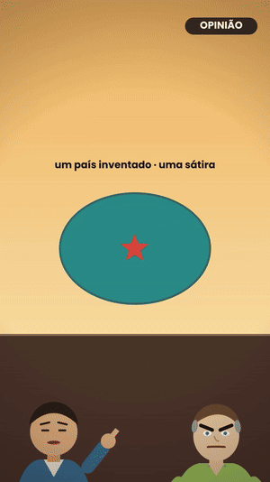
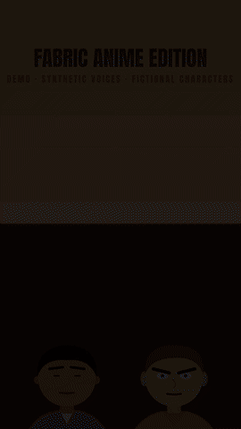
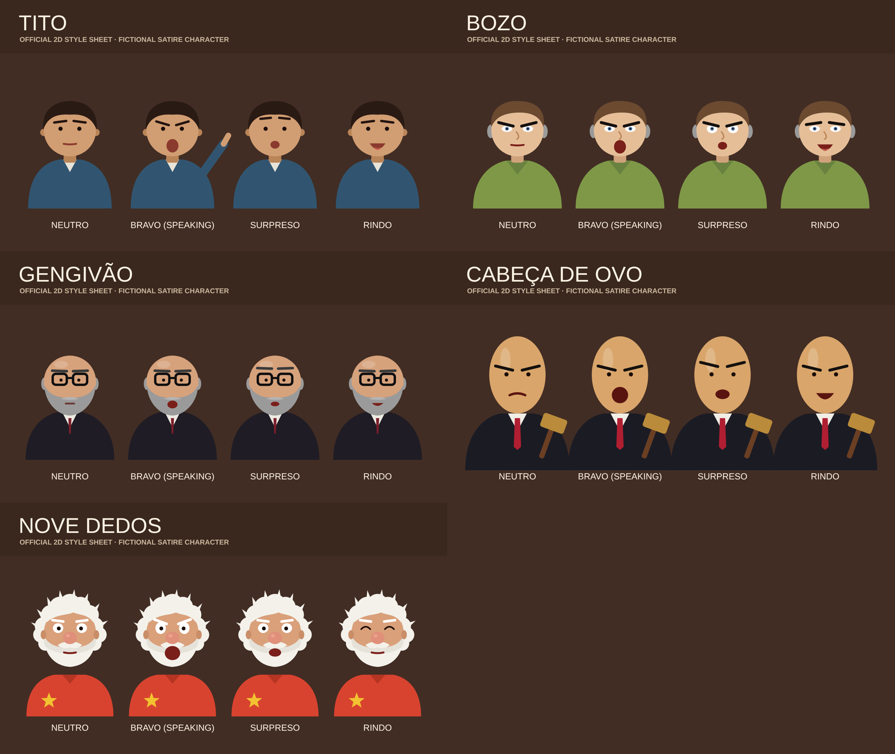
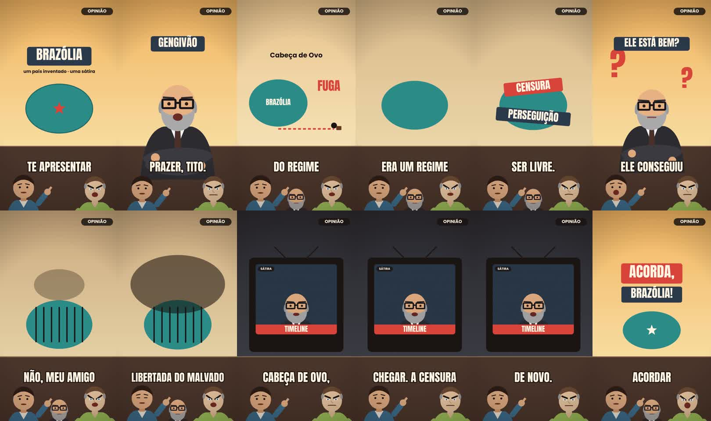

# Fabric Anime Edition

[🇬🇧 English](README.md) · **🇧🇷 Português**

> Uma fábrica aberta, guiada por código, de **vídeos curtos 2D em vetor plano** (pronta para 3D por desenho):
> roteiro → personagens → vozes → cortes → sincronia de legenda/boca → timeline editável → vídeo vertical.

<p align="center"> &nbsp; </p>

Nasceu de um pipeline de produção real (curtas satíricos no país fictício *Brazólia*). Este repositório extrai
**somente o que provou funcionar** e deixa o resto do estúdio de fora, para que quem chegar possa colaborar
sem precisar entender um motor grande e privado.

## O que funciona hoje (status honesto)

| Peça | Status | Onde |
|---|---|---|
| Quadro = função pura do tempo `R(t)`, renderizado com Playwright → ffmpeg | ✅ funciona | `engine/rend_cache.py` |
| Cache de quadros por hash de conteúdo (quadro idêntico é renderizado uma vez) | ✅ medido: demo 12,7 s → 2,3 s na 2ª execução, saída idêntica | `engine/rend_cache.py` |
| 5 personagens 2D oficiais, 4 expressões, boca pelo volume do áudio | ✅ funciona | `characters/personagens.js`, `media/characters/` |
| Roteiro → timeline → faixa de voz com igualação de loudness por fala e envelope de boca a 30 fps | ✅ funciona | `tools/build_audio.py` |
| Render em um comando + checagem de loudness (alvo ≈ −14 LUFS, TP ≤ −1,5 dBTP) | ✅ funciona | `tools/render_episode.py`, `tools/qa_audio.py` |
| Segurança de custo em APIs pagas: nunca pagar duas vezes pela mesma entrada; prévia aprovada antes | ✅ testado | `voice/job_estado.py` |
| Vozes além de uma API comercial (TTS aberto: Chatterbox, Qwen3-TTS) | 🧪 candidatos, **sem benchmark ainda** | [docs/ROADMAP.md](docs/ROADMAP.md) |
| Assistente de roteiro e personagens (guiado por LLM) | 📝 desenhado, não construído | [docs/ROADMAP.md](docs/ROADMAP.md) |
| Timeline editável (trocar legenda, pôr música, corrigir cortes) | 📝 contrato escrito, interface não construída | [docs/TIMELINE_CONTRACT.md](docs/TIMELINE_CONTRACT.md) |
| Personagens 3D | 📝 só um espaço reservado — nenhum 3D foi produzido ainda | `experimental/` (planejado) |

**Limites que você precisa saber:** a sincronia labial segue o *volume* do áudio, não os fonemas. O loudness é
*medido*, não *ouvido* — uma pessoa ainda precisa ouvir. As vozes do vídeo de exemplo vêm de um serviço de TTS
comercial (veja [LICENSE-ASSETS.md](LICENSE-ASSETS.md)).

## Amostras

| | |
|---|---|
|  | **Fichas do elenco** — Tito, Bozo, Gengivão, Cabeça de Ovo, Nove Dedos (`media/characters/`) |
|  | **Quadros de um episódio real** (56 s, 1080×1920): [`media/video/brazolia_ep1_sample.mp4`](media/video/brazolia_ep1_sample.mp4) |

- 🎬 Exemplo real (português, vozes de IA, sátira rotulada): `media/video/brazolia_ep1_sample.mp4`
- 🎬 Demo reproduzível (bipes sintéticos no lugar das vozes): `media/video/demo_synthetic_voices.mp4` ← refaça você mesmo abaixo.

## Começando

```bash
pip install -r requirements.txt && playwright install chromium   # + ffmpeg no PATH
python tools/render_episode.py examples/demo        # → examples/demo/out.mp4
python tools/fichas.py                              # regenera as fichas
pytest -q                                           # testes
```

Um episódio é só uma pasta: `episode.html` (define `window.R(t)`), `script.json`, áudios, `personagens.js`.
Leia primeiro [docs/ARCHITECTURE.md](docs/ARCHITECTURE.md); as regras visuais estão em [STYLE.md](STYLE.md).

## Como colaborar

Procuramos colaboradores — principalmente para: vozes de código aberto, o editor de timeline, um assistente de
roteiro, mais personagens no **mesmo estilo 2D** e um primeiro experimento em 3D. Comece por
[CONTRIBUTING.md](CONTRIBUTING.md) e pelo roadmap. Regra nº 1: **nenhuma mudança entra sem medição antes/depois** no mesmo trecho.

## Uso responsável

Sátira com país e personagens fictícios, sempre rotulada como sátira e como conteúdo gerado por IA.
Não use para imitar pessoas reais nem para produzir conteúdo político enganoso. Veja [DISCLAIMER.md](DISCLAIMER.md).

## Licença

Código: [MIT](LICENSE). Personagens, mídias de exemplo, fontes e vozes: [LICENSE-ASSETS.md](LICENSE-ASSETS.md) (não é MIT).
